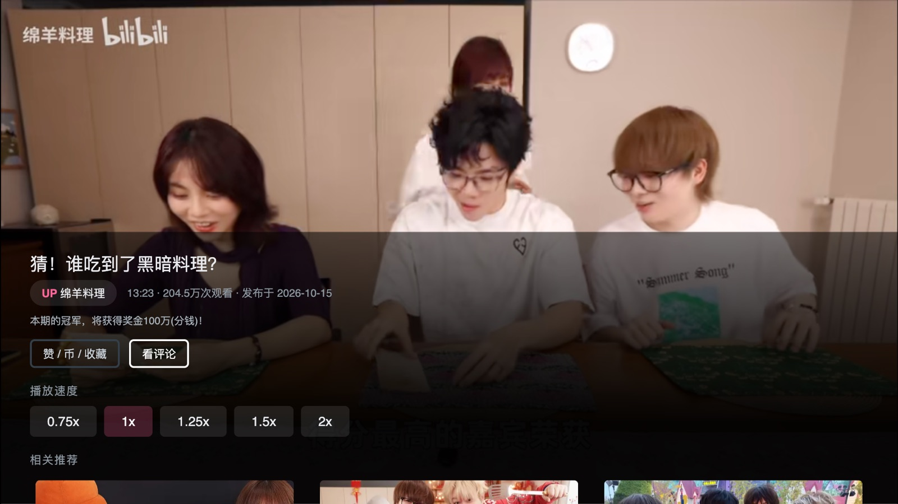
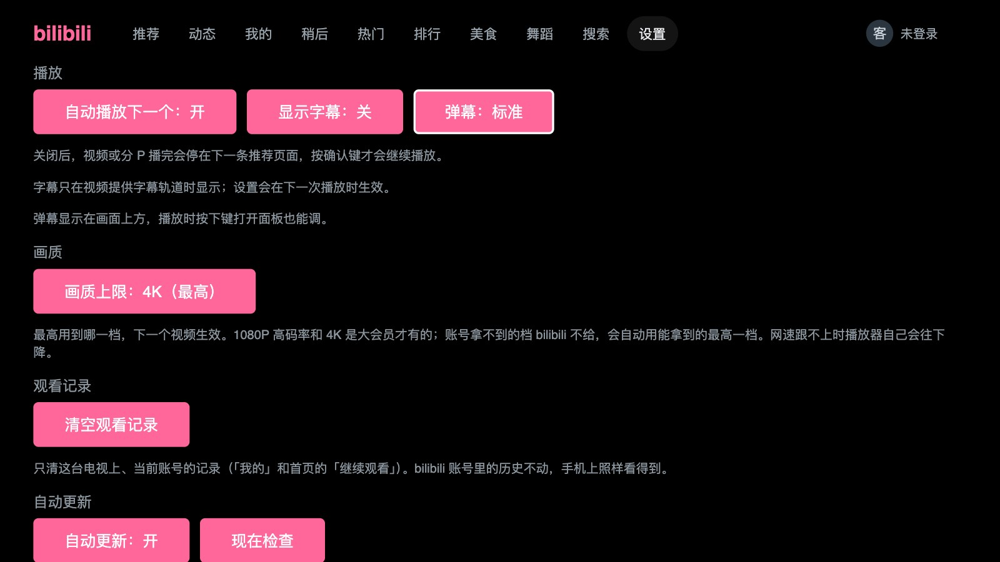
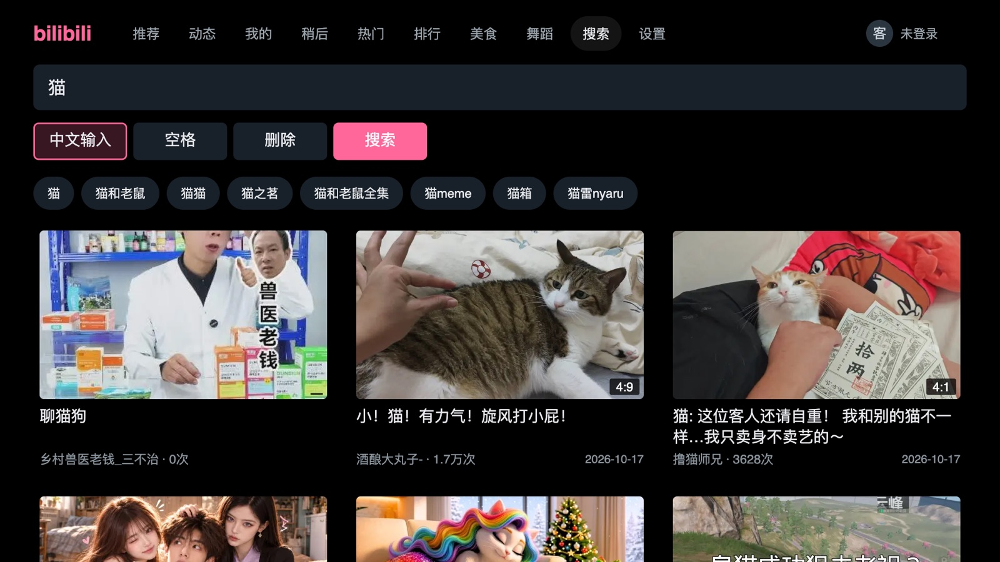
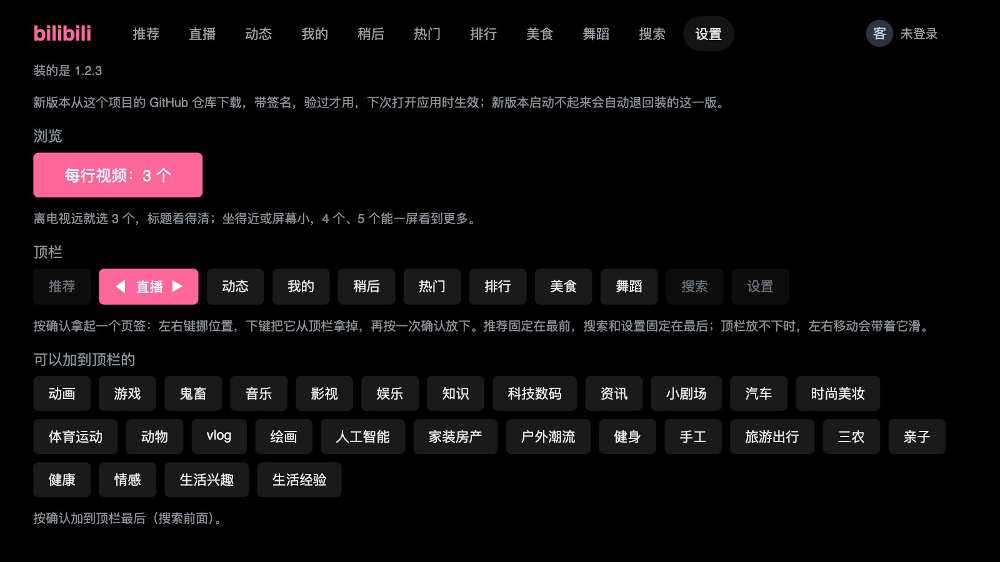

# 三星电视上的 bilibili

**中文 · [English](README.en.md)**

给三星 Tizen 电视做的 bilibili 客户端，全程遥控器操作。电视直连 bilibili：
**没有后端，没有代理，没有服务器，账号凭证只存在电视本机。**

一台电视上可以同时登多个账号，各自的观看记录互不干扰；在手机上看到一半的，
电视上接着播。

> LG webOS 有一个很好的 [bili-webos](https://github.com/asdf17128/bili-webos)，
> 三星这边一直是空的。这个项目补的是这个位置。
>
> **与 bilibili、三星均无关联。** 个人项目，MIT 协议。
>
> 兄弟项目：[douyin-tizen](https://github.com/titlog/douyin-tizen)（三星电视上刷抖音）、
> [telegram-tizen](https://github.com/titlog/telegram-tizen)（三星电视上放 Telegram 群和频道里的视频）。

|  |  |
|---|---|
|  |  |
| 3 列大卡片，从沙发上也看得清；登录后最上面一行是「继续观看」，开机光标就在上面 | 弹幕从右往左飘，不叠在一起，跟着暂停和倍速走；拖动时有缩略图预览；登录后最高 1080P H.265，大会员最高 4K |
|  |  |
| 播放中按下键拉出面板，**视频不停**：弹幕开关、点赞、投币、收藏、看评论、倍速一排，UP 主旁边能关注；分 P、合集（长的按 50 集分段，右边列出）、相关推荐。从相关推荐或 UP 主页按返回，回到刚才那个视频 | 边看边读评论和楼中楼，视频缩到一边接着播 |
|  |  |
| 设置：自动播放、字幕、弹幕、画质上限、清空观看记录、自动更新、诊断日志，每行几个视频按电视大小和离沙发多远来选 | 搜索，可切到电视自带的中文输入法 |
|  |  |
| 直播：你关注的主播在播的排最前，后面是全站按人气；进去之后上下键换直播间，像换台 | 顶栏自己排：拿起一个页签左右挪、下键拿掉，下面那排按一下就加上 |

## 我的电视能装吗

| | |
|---|---|
| **实测可用** | 三星 2023 年款 65 吋 **CU7090**，固件 Tizen 9.0（Chromium 120）。这个项目的所有测量都来自这一台 |
| **社区实测** | 三星 2020 年款 55 吋 **Q90T**，Tizen 5.5（Chromium 69）。[PR #2](https://github.com/titlog/bilibili-tizen/pull/2) 的作者在他的分支上测的，老引擎的兼容就来自那里 |
| **大概率可用** | 2020 年以后的三星电视（Tizen 5.5 及以上）。播放走的是标准的 MSE 和 AVPlay，没有用到机型特有的东西——但**其余机型还没人试过** |
| **能装，没实测** | 2017–2019 年的三星电视（Tizen 3.0–5.0，Chromium 47–63），1.2.5 起放开安装。2018 年的 UA49NU7100（Tizen 4）跑过一个九月份的版本，界面出来了、封面错色（已修，[#1](https://github.com/titlog/bilibili-tizen/issues/1)）；播放还没人试过。**装了请开 issue 说一声好不好用** |
| **不行** | 非三星电视；三星 2016 年及以前的机型（Tizen 2.x） |

从源码装的构建启动时会上报引擎版本和编解码支持，第一件事就是看那一行（发布包不上报）。
**不管走哪条路，在别的机型上装成功或者失败，都请开一个 issue 说一声机型和固件版本**，
这张表就是这么长出来的。

## 安装

三星商店不收第三方客户端（2019 年非官方的 Twitch 应用就是因此被下架的），所以只能
侧载。**只需要一次**，之后电视上直接开，新版本也会自己装上（1.2.0 起）。两条路：

| | 装发布包（推荐） | 从源码装 |
|---|---|---|
| 适合 | 只想在电视上看 b 站 | 要改代码、要看诊断日志 |
| 需要 | 电脑（Windows / macOS / Linux）**或安卓手机**，装上 [Apps2Samsung](https://github.com/Apps2Samsung/Apps2Samsung) | macOS、Node、Python 3、Tizen Studio 命令行工具 |
| 升级 | 1.2.0 起自己更新；更早的版本用 Apps2Samsung 再装一次 | 1.2.0 起也会自己更新；`git pull` 再跑一次 `deploy.sh` 也行 |

**从 1.2.0 起，应用会自己更新**：开机一分钟后、没在播放时去这个仓库看有没有新版本，之后每 6 小时看一次；
下载、验签名，下次打开时生效；新版本启动不起来会自动退回装的那一版。

- **「下次打开」要真的退出再开**：在推荐页按返回键退出应用，再从电视主页打开。按主页键切到别的应用、
  或者关机再开机，电视往往只是把应用挂起，回来还是原来那一版。
- 「设置」页签里能关掉自动更新、能「现在检查」，下面一行写着装的是哪版、正在运行哪版、下好了哪版。
- 从源码装、自己改了代码的，记得在设置里把自动更新关掉 —— 不然仓库出了更高的版本，下次打开就换成仓库里的代码。
- 1.2.0 之前的版本（以及想换回某个旧版本时）升级是手动的。

**两条路都要先做这一步：** 电视上打开开发者模式——在「应用」页面用遥控器输入
`12345`，打开开关，Host PC IP 填装应用的那台电脑或手机的 IP——然后**把电视完整断电
重启一次**。不重启登记不生效，症状是找不到电视、或者连接静默超时。

**所有人都会卡在证书上，两条路都替你搞定。** 2023 年以后的三星电视只认三星签发的
分发证书，Tizen Studio 自带的那套一律 `Invalid certificate chain`。证书绑定电视的
DUID，要用你自己的三星账号登录一次来申请。

### 装发布包

1. 装 [Apps2Samsung](https://github.com/Apps2Samsung/Apps2Samsung/releases)，电脑版、
   安卓版都行。
2. 打开它，选中你的电视（列表里没有就手动输入电视的 IP）。
3. 在它的应用列表（社区目录）里找到 **bilibili**，安装。第一次会让你登录三星账号，
   替这台电视签证书。

社区目录每天从这里同步一次最新的发布包。想装目录还没同步到的新版本，或者某个指定版本：
到 [Releases](https://github.com/titlog/bilibili-tizen/releases/latest) 下载
`bilibili-tizen-<版本>.wgt`，第 3 步改选自定义 `.wgt`，选这个文件。

发布包安装时会被重新签成你自己的证书，所以同一个文件谁都能装。

**只有 iPhone？** Apps2Samsung 没有 iOS 版，侧载要一台电脑或者一部安卓手机。不过只需要装一次
（之后新版本电视自己装），借一台电脑装一次就够了。

### 从源码装

准备：Node、Python 3，以及
[Tizen Studio](https://developer.tizen.org/development/tizen-studio/download)
的命令行工具（**不需要装 IDE**）。`setup.sh` 会打开三星账号登录页、替你申请证书，
不需要 Eclipse、不需要 sudo、不需要证书管理器 GUI。

```bash
git clone https://github.com/titlog/bilibili-tizen.git && cd bilibili-tizen
zsh tools/setup.sh      # 只跑一次：找到电视、读 DUID、签证书，配置写在仓库外
zsh tools/deploy.sh     # 检查、签名、安装、启动，约 15 秒
```

> **两条路不要来回换。** 两边签名用的证书不同，电视不让一个证书签的包覆盖另一个证书
> 签的同名应用。要换路，先在电视上把旧的删掉再装——删掉会清空扫码登录和本机的观看
> 记录，账号要重新扫；回传到 bilibili 账号上的进度还在。

> 只想要证书、和本项目无关？它已经拆成独立工具
> **[samsung-tv-cert](https://github.com/titlog/samsung-tv-cert)**
> [](https://www.npmjs.com/package/samsung-tv-cert)
> —— `npx samsung-tv-cert --duid <你的DUID>`。对 Jellyfin、Twitch 社区版、你自己写的
> 应用都有用。

## 账号与隐私

- 扫码登录，任意多个账号，切换不用重新扫。
- **凭证只存在电视的本地存储里。** 没有统计、没有广告、没有第三方 SDK。流地址是预签名的，
  播放请求不携带你的账号。
- 电视上的观看进度会回传 bilibili（30 秒一次），手机和网页上就能接着看；反过来也一样。
- 点赞、投币、收藏会写到你的 bilibili 账号上，只有你在电视上选了才会发；投币撤不回来，
  要先选投几枚才会发。
- 默认走 **TV 登录**路径，用官方电视客户端的 appkey 签名——这是多账号和进度回传的
  前提，也意味着你的客户端对 bilibili 表现成官方电视客户端。这是一个使用条款层面的
  取舍，不是技术问题；不想这样可以改走网页扫码，代价是只能一个账号、进度不回传。
  两条路的差别摊开在 [`docs/登录路径.md`](docs/登录路径.md)。
- 令牌过期后需要重新扫码（续期接口没有对着服务器验证过，不敢猜着写）。
- **诊断日志（1.3.2 起）**：出问题时，应用会收集一些排查必要的运行信息传给开发者，不会泄露
  个人隐私。设置里可以关掉；报问题时附上设置页里显示的这台电视的编号。
- 从源码装时，`deploy.sh` 会把**你这台电脑的局域网地址**写进包里，作为开发用的实时日志
  去处，只在你的局域网内；这样的构建不往开发者的接收端传诊断日志。

## 能做的，和明确不做的

**能做的**：推荐 / 直播 / 热门 / 排行 / 分区 / 动态 / 稍后再看 / 搜索（电视自带中文
输入法），多分 P，续播（记住看到哪一 P，接着手机上的进度），自动播下一集，拖动预览，
播放中拉出分 P 与相关视频，UP 主页（播放面板里按 UP 主名字、或看完之后按右键，看这位
UP 主的全部投稿，返回键回到来的那个页签）。到画面约 **2.5–3.5 秒**，1080P H.265。

**直播**：顶栏「直播」里，你关注的主播谁在播排在最前面，后面是全站正在播的、按人气排；进去之后上下键换直播间，
和换台一样。没登录是超清，暂时没有直播弹幕。**顶栏自己排**：「设置」里能把直播、动态、我的、稍后、热门、排行和 30 个分区加到顶栏或拿掉，
也能调顺序（推荐固定在最前，搜索、设置在最后）；顶栏放不下时会跟着焦点左右滑。多分 P 的选集在播放面板里排成一行，左右滑着选。

还有：弹幕（设置里选 关 / 少 / 标准 / 多，面板里一键开关）；合集（50 集以内平铺，更长的按段折叠、选一段在右边列出，看完接下一集）；关注 UP 主（面板里和 UP 主页上）；
画质上限（默认最高：大会员可到 4K）和清空这台电视上的观看记录；「我的」里的收藏夹和关注的 UP 主；播放中边看边读评论（含楼中楼）；字幕；点赞、
投币、收藏（播放面板里和网页一样三个按钮，投币在按钮下面选投几枚，会同时点赞；卡片上长按确认键也能用）；以及「设置」
页签——自动播放下一个、字幕开关、每行几个视频（3 / 4 / 5，按你家电视多大、离沙发多远
来选）。这些来自 [PR #2](https://github.com/titlog/bilibili-tizen/pull/2)。

**不做的**：
- **手机投屏。** 投屏接收端必须在网络上监听端口，Tizen 的 web widget 做不到，和够不够
  官方无关。替代品是「稍后再看」：手机上点，电视上开。
- **给评论点赞、发评论。** 电视直接调评论的写接口会被拒（403），评论目前只读。

## 常见问题

**找不到电视，或者 `sdb` 连不上。** 开发者模式里登记的是不是装应用的那台电脑（或手机）
现在的 IP；改完有没有完整断电重启。DHCP 换了地址就要重登记。

**`Invalid certificate chain`（从源码装）。** 用了 Tizen 自带的证书。跑
`zsh tools/setup.sh` 换成三星签发的那套。

**已经用 Tizen Studio 的证书管理器建好了签名档。** 不用改脚本：在 `~/.bilibili-tizen.conf`
里写 `BILI_PROFILE="<签名档名字>"`，`deploy.sh` 就用它签，不再要 `setup.sh` 签的那套证书。

**安装时提示电视上已经有用别的证书签名的同名应用。** 之前走的是另一条路装的，见上面
「两条路不要来回换」。

**装上了，打不开某个视频，提示「视频流被拒绝（403）」。** 多半是 CDN 临时限流或者
按文件的拒绝，应用会自己换镜像、换令牌、换编码、压画质；提示出现说明这些都试过了，
过几分钟再试，或者换一个视频。

**「动态」「稍后再看」是空的。** 这两个标签要登录，先去「我的」扫码。

**改了代码没生效。** 看电视上报的启动行有没有变；`deploy.sh` 从 `config.xml` 推导包名，
改过应用名的话确认它推的是新包。

## 给开发者：这个平台的坑

客户端只是结果，真正花时间的是搞清楚这个平台到底能干什么。下面几条每一条都吃掉过
一整天，而且别处搜不到：

- **bilibili 不需要 `Referer`，但会按 UA 拒绝。** 用裸 `curl` 试探，每个响应都读起来像
  「需要 Referer」——这个假信号差点让整个项目上一个根本不需要的代理。
- **这个固件的 widget 发不出 `Cookie` 头。** Chromium 120 静默忽略 forbidden header，
  登录态只能走 query 里的 `access_key`。之前「允许设 Cookie 头」的结论是在只有一个账号
  时测的，那个测量根本没有区分能力。
- **同一稿件手机能放、电视不能，根因是 playurl 的 `platform`。** web 端点铸的流令牌会被
  CDN 严格节点 403，app 端点铸的被接受。
- **AVPlay 能播 DASH，但清单必须走 HTTP 到达**，而 widget 不能监听端口——所以 DASH 走
  MSE。同一堵墙也是投屏做不了的原因。
- **换 CDN 节点行不通、限流按 IP、镜像只能排序不能丢弃。** 哪台镜像是死的属于当天的
  天气，同一台主机一晚全 403、隔天整晚正常。

每条的来龙去脉在 [`docs/平台坑.md`](docs/平台坑.md)。[`CLAUDE.md`](CLAUDE.md) 是这个项目现在成立的结论、
怎么部署和调试，以及排查纪律；全部测量、日志判据和排查经过（包括那些推翻了先前结论的记录）按主题放在
[`docs/`](docs/) 里，CLAUDE.md 开头有一张文档地图。

## 目录

```
app/          客户端（ES5，IIFE，无构建步骤）
  vendor/     Shaka Player，预编译入库
spike/        当初摸清平台事实的工装
tools/
  setup.sh            只跑一次：你的电视、你的证书
  deploy.sh           检查、签名、安装、启动
  release.sh          打发布包：取自 HEAD、不带诊断地址、用不含个人信息的证书签名
  check.sh            部署和发布共用的检查，任何一项失败都拒绝打包
  samsung-cert.mjs    无 GUI 签发三星证书
  devserver.mjs       在桌面浏览器里跑客户端（截图、改界面不用部署）
  collect.mjs         :8099 上的诊断收集器
  lint.mjs            抓「调用了不存在的东西」
  *-verify.mjs        清单 / 账号 / md5 / 二维码 / 互动接口 / 长按导航 / 老引擎样式 ——
                      任何一个失败都拒绝发布
docs/         按主题的排查经过和测量：播放与 CDN、日志对照表、账号、界面、自动更新……
CLAUDE.md     现在成立的结论、部署与调试、踩过的坑（附文档地图）
```

## 怎么调试

零售机把一切方便的手段都关了：`dlog` 什么都不返回，Web Inspector 的端口从不打开，
`sdb shell` 直接 `closed`。所以应用自己上报——`tools/collect.mjs` 在 8099 端口监听，
`deploy.sh` 自动把地址写进构建。

```bash
node tools/collect.mjs | tee /tmp/bili.log   # 终端 1，先开
zsh tools/deploy.sh                          # 终端 2
```

收集器不在时上报静默失败；连续五次失败后应用会睡五分钟再试，所以开晚了的收集器最多
等五分钟就能收到东西，重新部署则立刻恢复。

```bash
zsh tools/deploy.sh --selftest
```

会在电视上无人值守地走一遍全流程：网格、播放、面板、滚动、拖动、跨缓冲区远距离跳转、
暂停、恢复、退出、账号页、设置、收藏夹与关注、评论、字幕，并逐步上报。
**这是唯一能在无人值守下检验一个构建的办法。**
跑完记得再装一次正常构建。

## 协议

MIT。bilibili 是其所有者的商标，本项目与之无关联。`app/vendor/` 里预编译的 Shaka
Player 带着 Apache-2.0、MIT、BSD-3-Clause 的第三方代码，见
[THIRD_PARTY_NOTICES.md](THIRD_PARTY_NOTICES.md)。
