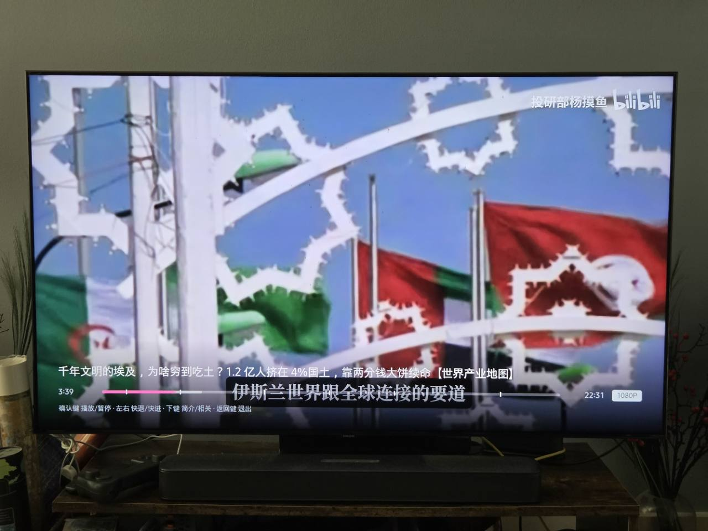
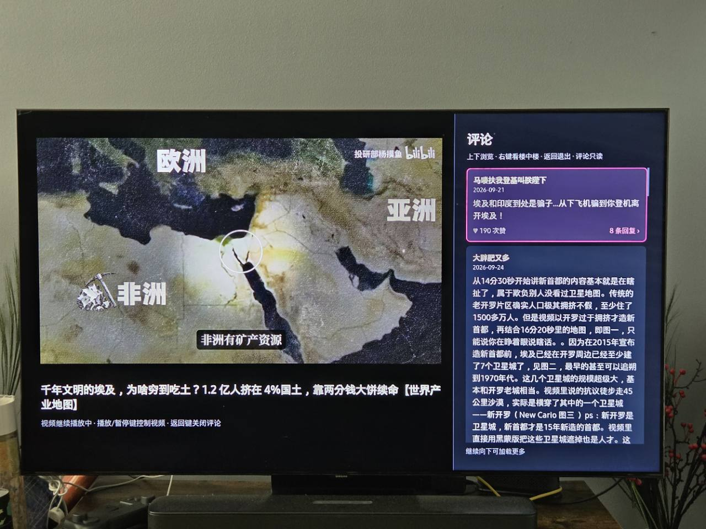
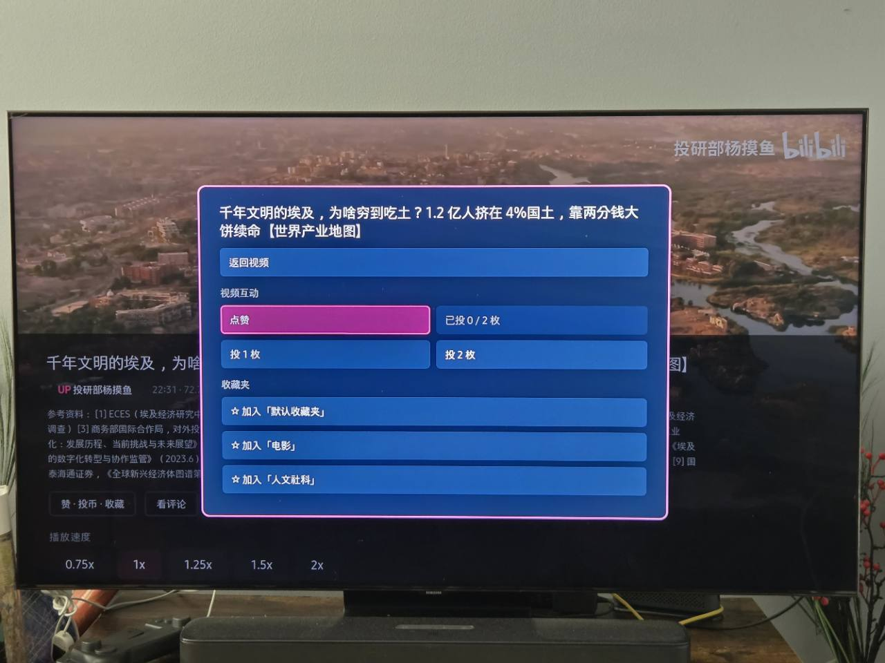
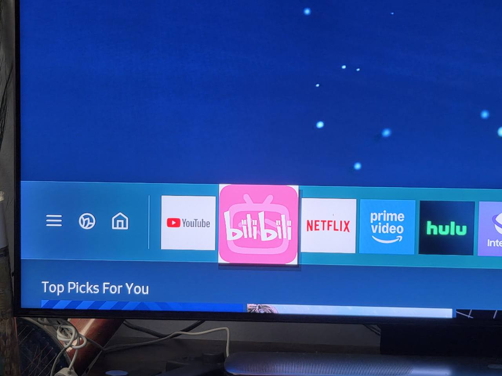

# 三星 Tizen 电视上的 bilibili

**中文 · [English](README.en.md)**

这是一个面向**较旧、或所在地区应用商店没有可用 bilibili 客户端的三星 Tizen 电视**的非官方定制客户端，用电视遥控器操作。它基于 [titlog/bilibili-tizen](https://github.com/titlog/bilibili-tizen) 改造，重点适配 **2020 年 Q90T / Tizen 5.5**。原项目的设计、客户端架构和大量功能由 **titlog** 开发；这份 Q90T 适配是在其成果上继续开发，并保留原作者的 [MIT 版权声明](LICENSE)。电视直接访问 bilibili，不需要电脑常驻提供播放服务。本项目与哔哩哔哩、三星没有关联。

| 一眼看清 | 内容 |
| --- | --- |
| **上游基点** | 原作者 **titlog** 的 [bilibili-tizen](https://github.com/titlog/bilibili-tizen)，基于 `master` 的 [提交 `76003faf3ae1a647a92c532b968e4896427530cb`](https://github.com/titlog/bilibili-tizen/commit/76003faf3ae1a647a92c532b968e4896427530cb)（**2026-10-02**）。这里标的是确切提交，不是上游发行版本号。 |
| **本兼容版** | **1.0.12**；保留上游 MIT 版权与署名，作为独立的社区衍生版本维护，计划把改动提交给上游审阅。 |
| **真机测试** | **三星 55 吋 Q90T（QN55Q90TAFXZA）/ Tizen 5.5 / 固件 2743**。安装、扫码登录及主要遥控器操作已在这台电视上测试；其他机型尚未验证。 |
| **本版重点** | Tizen 5.5 适配、4/5 列紧凑布局和发布日期、收藏与关注、长按视频操作、边播边读评论、字幕与自动播放设置、令牌到期日期。下方有[逐项改动](#相对原项目增加了什么)。 |

安装后电视应用列表中的名称是 **Bilibili Tizen 兼容版 / Compatibility**；名称不限定 Q90T，但目前仍只有 Q90T 真机验证。

当前是**源码与真机测试阶段**：55 吋 Q90T、固件 2743 上已完成人工测试。其他机型、其他地区及较新固件仍需反馈；「满足最低 Tizen 版本」不代表「全部功能已验证」。

## 实际运行画面

以下为 Q90T 真机实拍。公开版本只移除了照片文件内的元数据，画面像素未修改。


*主界面。*



*视频播放页面。*



*边看视频边阅读评论的页面。*



*对视频点赞的操作页面，也可投币或加入收藏夹。*



*在电视上安装完成后，应用出现在电视的应用栏中。*

## 什么情况下适合安装

- 你的三星电视是 Tizen 系统，所在地区的应用商店找不到可用的 bilibili 客户端，而你想直接用遥控器浏览和播放。
- 你愿意开启电视开发者模式，并用同一局域网内的电脑为**自己的电视**签名和安装应用。安装后日常观看不需要电脑开机。
- 你接受非官方客户端依赖 bilibili 接口：登录、视频源、清晰度和互动功能可能随服务端变化而失效。

如果电视商店已有满足需求的官方客户端，优先尝试官方客户端。这个项目不是 Android APK，也不能把 APK 拷到 U 盘直接安装到 Tizen 电视。

## 机型与系统兼容性

| 范围 | 当前结论 |
| --- | --- |
| **已实测** | 三星 55 吋 Q90T（2020 年款，固件 2743）。项目包声明最低 Tizen 5.5。 |
| **可尝试，未实测** | 其他 2020 年款 Tizen 5.5 电视，以及 2021 年及更新的 Tizen 电视。能否安装、解码、显示完整界面和使用登录接口，仍需逐机验证。 |
| **当前包不支持** | 2019 年及更早、系统版本低于 Tizen 5.5 的电视；非三星 Tizen 电视以外的平台。 |

三星的[机型分组表](https://developer.samsung.com/smarttv/develop/specifications/tv-model-groups.html)把 2020 年 Q90 系列列在 Tizen 5.5 组；[Web 引擎规格表](https://developer.samsung.com/smarttv/develop/specifications/web-engine-specifications.html)列出各年份的系统与浏览器版本。本项目的最低版本以 [app/config.xml](app/config.xml) 中的 `required_version="5.5"` 为准。固件更新与机型支持可能不同，提交兼容性反馈时请注明**完整型号、固件版本、安装是否成功、能否播放**；不要公开电视 DUID、证书或登录信息。

**官方 bilibili 客户端的最低 Tizen 版本目前没有查到可核验的公开说明。** 三星将 2023 年机型列为 Tizen 7.0，但这只是三星的机型与系统对应关系，不能推导出 bilibili 官方客户端从 7.0 开始支持；应用自己的最低版本要由其包配置声明，参见[三星开发者说明](https://developer.samsung.com/smarttv/develop/faq/specifications-and-feature-support.html)。官方应用是否出现在商店，还与[电视型号对应的商店地区](https://developer.samsung.com/tv-seller-office/faq/tv-seller-office-use.html)有关。**如果你的电视低于 Tizen 7.0，但至少是 5.5，且当地商店没有可用的 bilibili 客户端，可以尝试本兼容版**；这只是本项目的尝试范围，不代表官方应用有 7.0 的门槛。先在自己的电视商店搜索，再决定是否安装。

## 已实现的功能

| 位置 | 功能 |
| --- | --- |
| 首页与发现 | 推荐、继续观看、动态、稍后再看、热门、排行和分类页；视频卡片显示 UP 主、播放量与发布日期；每行可选 4 或 5 个视频。 |
| 搜索 | 遥控器英文键盘、搜索建议和历史词；可输入拼音并从建议中选择中文词。真正的中文输入尚未实现。 |
| 「我的」 | TV 二维码扫码登录、多账号切换、观看历史、收藏夹、关注的 UP 主及其投稿。部分内容需要先登录。 |
| 播放 | 最高请求 1080P（仍取决于片源、账号权限、网络与解码能力）；播放/暂停、快进/快退、多分 P、续播、拖动预览、倍速、相关推荐和 UP 主投稿。 |
| 视频操作 | 卡片长按确认键或播放信息面板中可点赞/取消赞、投 1 或 2 枚硬币、加入/移出指定收藏夹；投币需二次确认。「我的收藏」可移出视频。 |
| 评论 | 视频继续播放时在右侧阅读评论；支持进入楼中楼。当前只读，不能点赞、发表或回复。 |
| 设置 | 自动播放下一条开关、字幕开关（仅视频提供字幕时有效）、每行 4/5 个视频；在「设置 → 账号」查看 TV 令牌标称到期日期。 |

视频清晰度标签表示客户端请求到的档位，不保证每个视频或网络条件下都稳定达到该档位。当前不支持 4K、弹幕播放、可靠的中文拼音输入，也不提供手机向本应用投屏。电视观看进度**写回 bilibili 目前有 HTTP 403 问题**；电视本机续播可用，但不要假定手机上一定同步到同一位置。详情见 [BUGS.md](BUGS.md)。

## 相对原项目增加了什么

原项目 **[titlog/bilibili-tizen](https://github.com/titlog/bilibili-tizen)** 由 **titlog** 开发；本版以其 [2026-10-02 的 `76003fa` 提交](https://github.com/titlog/bilibili-tizen/commit/76003faf3ae1a647a92c532b968e4896427530cb)为基点。上游已提供推荐与分类、搜索、扫码和多账号登录、视频播放与多分 P、续播、拖动预览、播放中的相关推荐及 UP 主投稿等基础能力。本兼容版保留这些成果，在此基础上增加或调整了：

1. **Q90T / Tizen 5.5 适配：**降低应用声明的最低系统版本，并处理旧版电视浏览器与播放界面的兼容问题；目前只在 2020 年 Q90T 上实测。
2. **更紧凑的视频网格：**每行可选 4 或 5 张卡片，减少单屏留白；卡片和视频详情加入发布日期。关注 UP 主的投稿也显示日期，长名称优先保留，空间不足时压缩日期格式。
3. **「我的」内容扩展：**浏览自己的收藏夹、收藏视频、关注的 UP 主及其投稿；可以从收藏夹移出视频。
4. **视频互动：**浏览卡片时长按确认键打开独立菜单，播放信息面板也可进入；支持视频点赞/取消赞、投 1 或 2 枚硬币、加入/移出指定收藏夹。投币前有二次确认，方向键仍直接切换卡片。
5. **边看边读评论：**播放画面缩到左侧，右侧显示评论和楼中楼；视频可继续播放。评论目前只读，评论点赞仍列在待办。
6. **播放与设置：**加入自动播放下一条开关、字幕显示开关、卡片密度选择；播放信息面板默认选中「看评论」，并提供视频操作入口。
7. **导航修复：**修复相关推荐中首张卡片初次按下键不能进入下一排的问题，移除无法正常进行中文输入的按钮；真正的拼音输入保留在待办。
8. **登录有效期提示：**在设置页显示本机保存的 TV 访问令牌标称到期时间，不在首页占空间，也不展示令牌本身。

这份清单描述相对上游的改动，不表示所有列出的功能都由本分支从零设计。仍未解决的问题和计划分别见 [BUGS.md](BUGS.md)、[FEATURES.md](FEATURES.md)。

## 遥控器基本操作

| 场景 | 操作 |
| --- | --- |
| 浏览卡片 | 方向键移动；短按中间确认键播放；**长按确认键约 0.65 秒**打开点赞、投币、收藏菜单。 |
| 播放中 | 中间确认键播放/暂停；左右键快退/快进；下键打开信息面板，默认选中「看评论」；返回键退出视频。 |
| 信息面板 | 查看简介、发布日期、分 P、倍速和相关推荐，也可打开视频操作菜单或评论。 |
| 评论侧栏 | 视频继续播放；上下键选评论，右键进入有回复的评论，返回键先回一级评论、再关闭侧栏。遥控器的播放/暂停键仍可控制视频。 |
| 搜索与偏好 | 顶部「搜索」输入或选建议；顶部「设置」切换自动播放、字幕和卡片密度。 |

方向键用于切换视频卡片，不会先停在卡片里的互动按钮上。实际遥控器按键名称和长按事件可能因机型不同而变化。

## 安装与更新

**目前自动化安装脚本面向 macOS 的 zsh 环境**；Windows 可参考下方的 Tizen Studio 手动流程，但尚未在一台全新配置的 Windows 电脑上完整复核。Linux 也尚未验证。Mac 需要 Node.js、Python 3、zsh、三星账号，以及带 Samsung TV 扩展与证书组件的 [Tizen Studio 工具链](https://developer.samsung.com/smarttv/develop/getting-started/setting-up-sdk/installing-tv-sdk.html)。`sdb` 与 `tizen` 命令需可运行。

1. 在电视 **Apps → 设置** 页面用遥控器输入 `12345`，打开 Developer mode，把 Mac 的局域网 IP 填入 Host PC IP，确认后重启电视。三星的[官方步骤](https://developer.samsung.com/smarttv/develop/getting-started/using-sdk/tv-device.html)包含各界面示意。电视不必关闭其他应用，也不需要 U 盘。
2. 获取**包含本 Q90T 兼容版本**的源码，进入项目目录。首次运行先安装证书脚本依赖，再按提示完成电视 IP、DUID 和三星证书配置：

   ```bash
   npm ci --prefix tools
   zsh tools/setup.sh
   ```

3. 安装并启动：

   ```bash
   zsh tools/deploy.sh
   ```

**Windows 手动安装（尚待其他电脑复核）：**按照三星的 [SDK 安装说明](https://developer.samsung.com/smarttv/develop/getting-started/setting-up-sdk/installing-tv-sdk.html)安装 Tizen Studio、TV Extensions 和 Samsung Certificate Extension。在电视开启开发者模式、将 **Windows 电脑的局域网 IP** 填入 Host PC IP 并重启后，在 Tizen Studio 建立 Tizen 5.5 或更新版本的 TV Web 项目，把本仓库 `app/` 中的 `config.xml`、`index.html`、`icon.png`、`css/`、`js/`、`vendor/` 放入项目；不要复制 `Debug/`、`Release/` 或本机生成的配置文件。用 Certificate Manager 创建包含**自己电视 DUID** 的 Samsung 证书，在 Remote Device Manager 连接电视（端口 `26101`），选择电视后对项目执行 **Run As → Tizen Web Application**。三星分别提供[导入现有 Web 项目](https://developer.samsung.com/smarttv/develop/getting-started/creating-tv-applications/importing-tv-applications.html?device=htv)和[连接并运行到电视](https://developer.samsung.com/smarttv/develop/getting-started/using-sdk/tv-device.html)的图文步骤。若更新已有安装，请保留相同应用 ID 和作者证书；安装过程仍可能要求重新登录。

**不会侧载？可以请能操作你电脑的 AI agent 协助。** 先让电视与电脑处于**同一可互通的局域网**（通常是同一个家庭 Wi-Fi；访客网络或设备隔离可能阻断连接）。你在电视上登录自己的三星账号，在 **Apps → 设置** 输入 `12345` 开启 Developer mode，把**这台电脑的局域网 IP** 填入 Host PC IP，确认并重启；这是[三星官方的开发设备连接流程](https://developer.samsung.com/smarttv/develop/getting-started/using-sdk/tv-device.html)。接着让有本机电脑访问权限的 agent 阅读本节和仓库源码，协助安装 Tizen Studio、创建**你自己的**电视签名证书、连接电视、打包并侧载，最后核对电视上实际运行的版本。三星账号登录、授权页面和电视遥控器步骤由你亲自完成；证书私钥、密码、电视 DUID 与登录资料只留在本机，不要贴到公开对话或提交到仓库。纯聊天机器人若无法操作这台电脑，不能独自完成侧载。无需 U 盘，安装完成后也无需让电脑一直开着。

`setup.sh` 会将电视与电脑的本地配置写在仓库外；签名证书与密码也留在个人电脑上。**不要把 DUID、证书私钥、密码文件或已经登录的应用数据上传到 GitHub。** 分发给其他电视时，使用者应以自己的三星账号和电视 DUID 签名。打包好的 `.wgt` 不是跨电视通用的 Android 安装包。

日常使用只需在电视上打开 APP。更新源码后再运行 `deploy.sh`；如果电脑局域网 IP 改变，须更新电视中的 Host PC IP。三星说明[普通应用更新会保留本地 Web 存储，而卸载会删除](https://developer.samsung.com/smarttv/develop/faq/data-and-file-handling.html)。我们在 Q90T 上观察到 Windows 版 `tz install` 曾先卸载旧包并清除登录；`sdb install` 虽显示传输成功，电视端却仍运行旧界面，**不能把传输成功当作更新完成**。其他机型与安装命令仍需实测。若改了应用 ID、卸载重装或清除数据，也需重新扫码；更新前请预期可能需要重新登录。

## 登录能保持多久？

**不是每周强制扫码，也不能承诺永久有效。** 默认 TV 二维码登录会返回 `access_token`、`refresh_token`、Cookie 和有效秒数 `expires_in`。应用把 `savedAt + expires_in` 保存为**访问令牌的标称到期时间**，登录资料存在电视本机；关机重开通常不需要重新扫码。当前版本**没有自动续期**，也没有在到期时主动删掉本地账号。服务端若不再认可会话，相关页面或操作可能先失败，此时到「我的」重新扫码。

默认 TV 登录使用社区已知的电视客户端签名参数，向 bilibili 表现为其电视客户端；这不是 bilibili 对本项目的授权。若你不接受这种登录方式，请先阅读[两条登录路径的说明](docs/登录路径.md)。TV 路径不可用时应用会退回网页扫码；该路径的账号恢复与多账号能力有限。

[社区整理的 TV 扫码接口样例](https://github.com/pskdje/bilibili-API-collect/blob/main/docs/login/login_action/QR.md)给出的 `expires_in` 是 **15,552,000 秒，约 180 天**。**2026-10-15 的一次 Q90T 真机测试中，使用者重新扫码后在「设置 → 账号」看到的标称到期日期为 2027-04-13，日期相隔约 180 天。**这是单次实测观察，不公开账号或令牌，也**不是 bilibili 对本项目或所有账号的有效期保证**；B 站可能改变签发时长，也可能提前撤销会话。

从 **1.0.12** 起，电视 APP 在**「设置 → 账号」**显示当前账号访问令牌的标称到期日期，只展示日期，不展示令牌。日期按电视登录时的时钟计算，电视时间或时区不准也会影响显示。它不等同于服务端实时确认的「还可登录到哪天」。网页扫码兜底路径没有可读取的令牌到期字段，无法给出相同日期。若重新扫码、卸载应用或服务端提前使会话失效，日期也会随之失去参考意义。

## 已知问题与后续计划

- **Bug：**电视观看进度上报返回 HTTP 403，可能无法同步到手机；评论点赞写入也返回 HTTP 403，因此评论目前只读。复现情况及排查方向见 [BUGS.md](BUGS.md)。
- **待加功能：**电视独立完成评论点赞、弹幕显示和密度控制、真正的中文拼音输入；后续评估更新时保留账号与设置、登录凭证自动续期、字幕轨道选择。需求与优先级见 [FEATURES.md](FEATURES.md)。

这两个文件分别记录问题与需求。发现新机型可用或不可用，也欢迎附上可复现步骤和**不含账号凭证**的日志。

## 常见问题

**安装时 `sdb` 连不上。** 确认电视已开机、开发者模式里登记的是这台电脑当前的 IP、电视与电脑互通，并在修改 Host PC IP 后重启电视。

**安装时提示证书链无效。** 检查是否使用了为这台电视签发的 Samsung 证书，而不是仅有通用 Tizen 证书。

**搜不到中文或无法像手机一样打字。** 目前只有英文遥控器键盘；可先输入拼音、选搜索建议。此前无效的「中文输入」按钮已移除，真正的中文输入列在 [FEATURES.md](FEATURES.md)。

**突然要求重新登录。** 先确认是否卸载/换应用 ID，再到「我的」检查是否显示会话失效。当前没有自动续期；重新扫码不会要求电脑常驻。

**视频无法播放或只有低清晰度。** 不同视频与账号权限可用的档位不同；网络、CDN 和电视解码能力也会影响播放。可稍后重试或换视频。不要把播放流的 403 与 [BUGS.md](BUGS.md) 中的进度上报 403 混为一谈。

## 项目结构与贡献

- `app/`：Tizen Web APP，`config.xml` 声明最低系统版本；`app/js/` 为客户端逻辑。
- `tools/`：首次配置、证书、打包安装和诊断脚本；目前自动化流程面向 macOS。
- 提交改动前运行 `npm ci --prefix tools`、`npm test --prefix tools`；检查包括语法、脚本引用、账号与播放底层验证，以及本兼容版的视频操作接口和遥控器长按/翻页回归测试。GitHub Actions 会在推送和 PR 时执行同一命令。真机播放、登录与接口可用性仍需另行验证。
- `docs/`：开发过程与平台排查资料，其中部分内容记录的是上游另一台电视的测试，**不能直接当作 Q90T 的实测结论**。
- [FEATURES.md](FEATURES.md) 与 [BUGS.md](BUGS.md)：需求和缺陷清单。

这份 Q90T 适配基于 **[titlog/bilibili-tizen](https://github.com/titlog/bilibili-tizen)**，感谢原作者 titlog 建立并公开三星 Tizen 版 bilibili 客户端。本分支主要针对 Q90T / Tizen 5.5 调整兼容性、遥控器交互、布局、账号和视频操作体验，并记录该机型的已知限制；请勿将这些改动误认为从零开发的独立项目。代码继续按上游 [MIT 协议](LICENSE)开放，发布衍生版本时须保留原版权与许可证，并注明上游来源。播放器依赖的授权见 [第三方组件说明](THIRD_PARTY_NOTICES.md)。

账号凭证只保存在电视本地并随请求提交给 bilibili；项目没有播放代理或账号服务器。可选的诊断收集器仅在电脑上手动启动时接收应用发往局域网的日志，公开 issue 前请检查日志中的账号名、视频标题与设备信息。仓库不包含用户证书、电视 DUID、账号令牌或签名后的个人安装包；每位使用者应为自己的电视单独签名。
